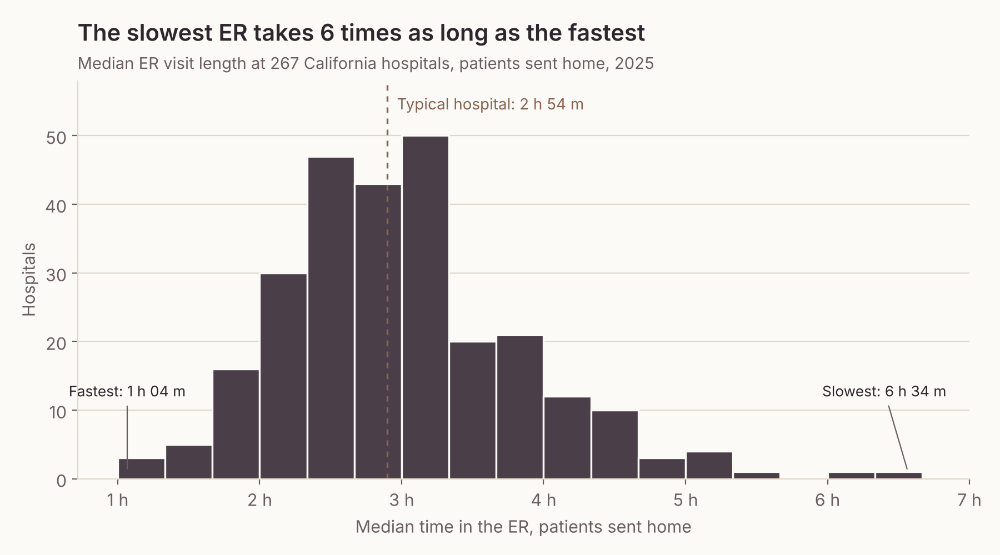
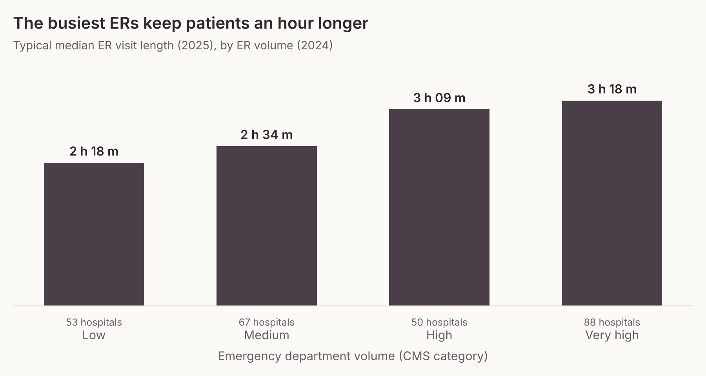
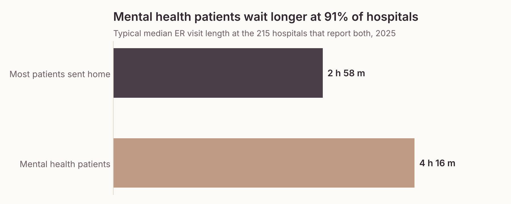
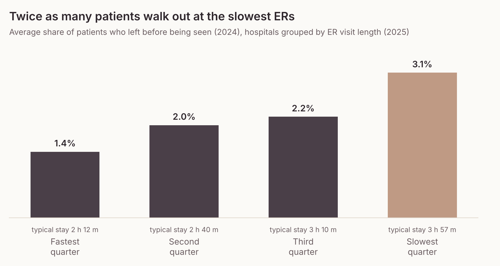
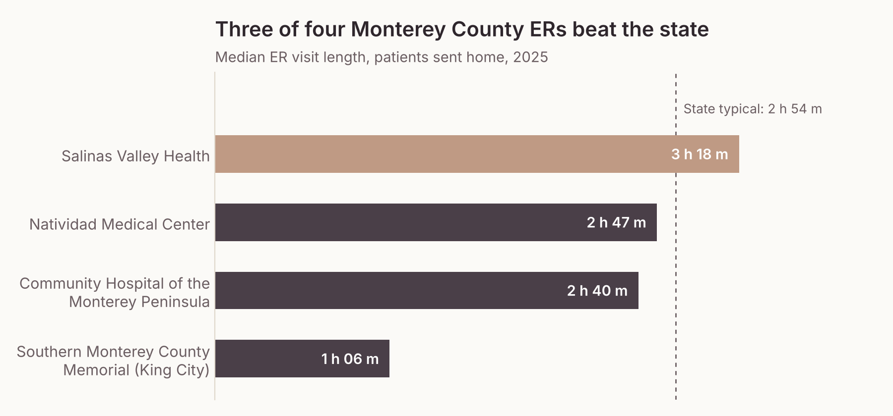

# California ER Wait Times: Who Waits Longest?

Medicare publishes how long patients spend in the emergency room at every hospital it pays. I analyzed the California file, **267 hospitals** with 2025 results, to see where ER visits run long and who waits longest.

**The short answer:** the typical California ER visit lasts **2 hours 54 minutes**, but the slowest hospital takes **6 times** as long as the fastest, and mental health patients stay longer at **9 of every 10** hospitals.



## The question

Long ER visits frustrate patients, tie up beds and push some people to leave before a doctor sees them. A hospital leader or county health planner would want to know:

1. How much do ER visit times vary across California hospitals?
2. Which hospitals and which patients face the longest stays?
3. Do long stays lead more patients to walk out?

## The data

**Source:** Centers for Medicare & Medicaid Services (CMS), [Timely and Effective Care – Hospital](https://data.cms.gov/provider-data/dataset/yv7e-xc69), filtered to California: 11,356 rows covering 328 hospitals.

| Measure | What it means | Period |
|---|---|---|
| OP-18b | Median minutes from ER arrival to departure, patients sent home | 2025 |
| OP-18c | The same, for psychiatric and mental health patients | 2025 |
| OP-22 | Percent of patients who left before being seen | 2024 |
| EDV | ER volume category, low to very high | 2024 |

**Limits.** CMS measures total time in the ER, arrival to departure, not only time in the waiting room. Each figure is one hospital's median, so it says nothing about any single patient's visit. Times aren't adjusted for how sick patients are, and the walkout and volume figures come from 2024, a year earlier than the times.

## Process

I followed the six-step data analysis process: ask, prepare, process, analyze, share, act.

**Cleaning**
- Kept the seven emergency department measures and set aside the other 40-plus quality measures.
- Reshaped the data from one row per hospital per measure to one row per hospital, so each ER's results sit side by side.
- Turned "Not Available" scores into blanks rather than zeros (CMS footnotes show these usually mean too few cases or no data submitted).
- Left out the 61 hospitals with no 2025 visit time, leaving 267 for the main analysis.

**Analyzing**
- Described the spread of visit times and named the fastest and slowest hospitals.
- Compared visit times by ER volume, and mental health patients with other patients at the 215 hospitals that report both.
- Split hospitals into four equal groups by visit time and compared how many patients left before being seen.
- Pulled out the four Monterey County hospitals as a local example.

## Key findings

### 1. The slowest ER takes 6 times as long as the fastest
At the typical hospital, a patient sent home spends 2 hours 54 minutes in the ER. The fastest, Trinity Hospital, takes about an hour. The slowest, Loma Linda University Medical Center, takes 6 hours 34 minutes, and most of the slowest ten are large university and county hospitals in Los Angeles, Sacramento and San Francisco.

### 2. The busiest ERs keep patients an hour longer
The lowest-volume ERs have a typical visit of 2 hours 18 minutes. The very-high-volume group runs 3 hours 18 minutes.



### 3. Mental health patients stay longer almost everywhere
At the 215 hospitals that report both measures, mental health patients stay longer at 91% of them: a typical 4 hours 16 minutes, versus 2 hours 58 minutes for other patients. At 39 hospitals the median mental health visit lasts 6 hours or more.



### 4. Twice as many patients walk out at the slowest ERs
At the fastest quarter of hospitals, an average of 1.4% of patients left before being seen. At the slowest quarter it's 3.1%. The link is moderate (Spearman correlation 0.34), since staffing and other factors also drive walkouts.



### 5. Three of four Monterey County ERs beat the state
Community Hospital of the Monterey Peninsula, Natividad and Southern Monterey County Memorial in King City all come in under the state's typical 2 hours 54 minutes. Salinas Valley Health runs longer, at 3 hours 18 minutes.



## Recommendations

1. **Track mental health visits on their own.** The gap shows up at nearly every hospital, so a single ER average hides it. Set a separate target for mental health visit time, starting with the 39 hospitals at 6 hours or more.
2. **Learn from busy ERs that still run fast.** Volume explains part of the delay, not all of it. Comparing high-volume hospitals with short visits against those with long ones would show which practices are worth copying.
3. **Use walkouts as an early warning.** The share of patients leaving before being seen tends to rise with visit length and is reported separately, so it can flag trouble early.
4. **Look closer at Salinas Valley Health.** It's the one Monterey County ER above the state's typical time; a follow-up could compare its volume and patient mix with Natividad, the other large ER in Salinas.

## Tools

- **Python (pandas):** filtering, reshaping (long to wide) and summarizing the CMS data
- **Python (matplotlib):** charts

## Repository layout

```
data/raw/ca_timely_effective_care.csv   CMS file, California rows only
data/processed/er_by_hospital.csv       one row per hospital with the ER measures
scripts/analyze_er.py                   reshapes the data and prints the findings
scripts/charts_er.py                    draws the five charts
charts/                                 chart images used above
```

## How to reproduce

```bash
pip install -r requirements.txt
python scripts/analyze_er.py   # writes data/processed/er_by_hospital.csv and prints the results
python scripts/charts_er.py    # writes charts/
```

To use a newer release, download the full CSV from the CMS dataset page linked above, keep the rows where State is CA, and save it as `data/raw/ca_timely_effective_care.csv`.

The charts use the Inter font if it's installed and fall back to the default font otherwise.

## Next steps

- Add the state and national benchmarks CMS publishes, to compare California with the rest of the country.
- Compare 2024 with 2025 to see which hospitals improved.
- Join CMS's hospital information file to compare ERs by ownership and hospital type.
